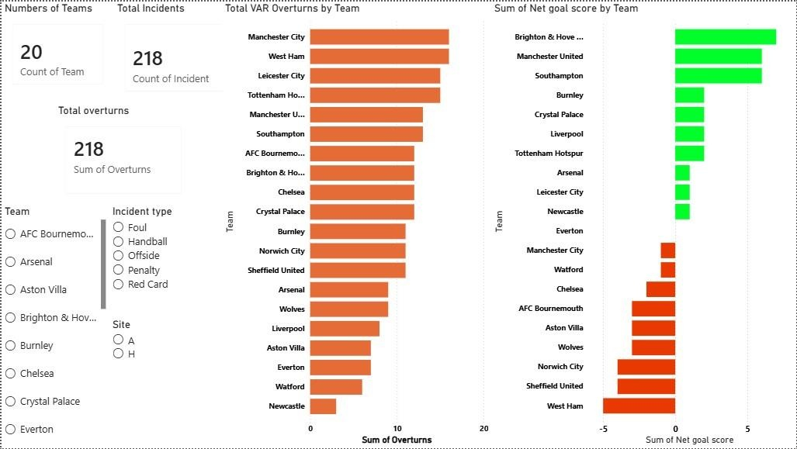
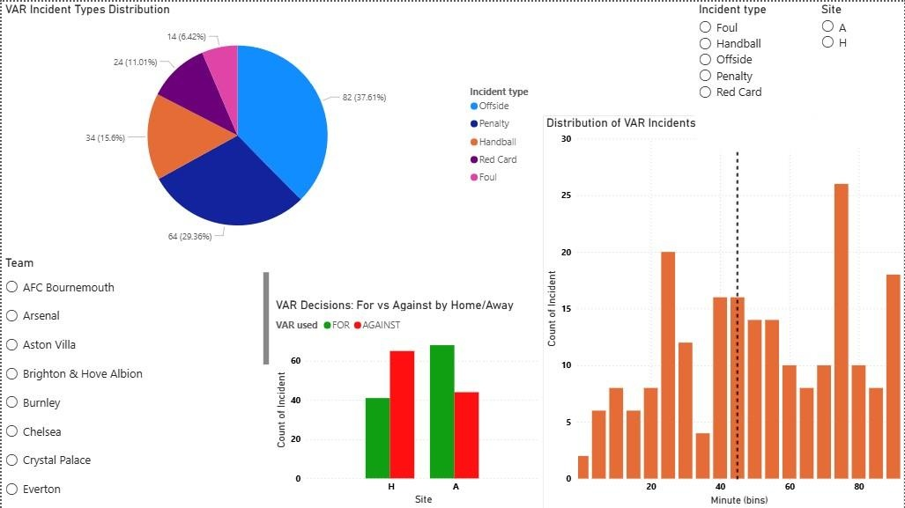
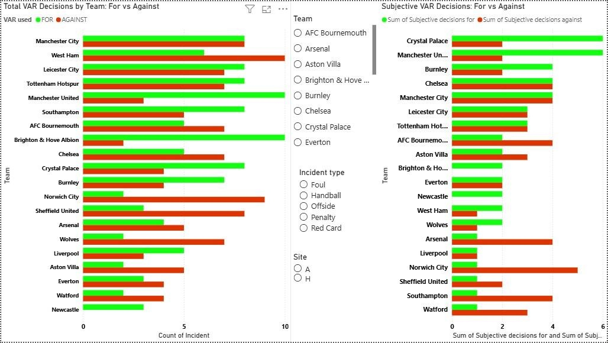
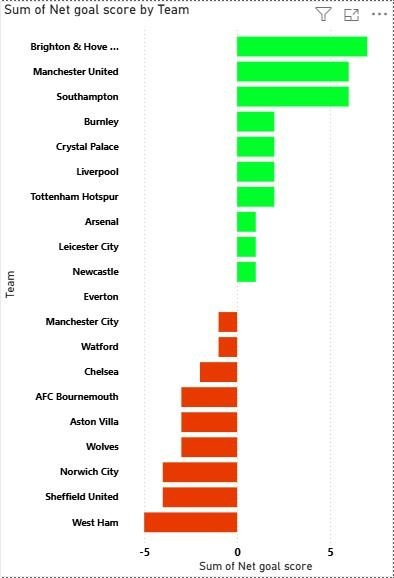
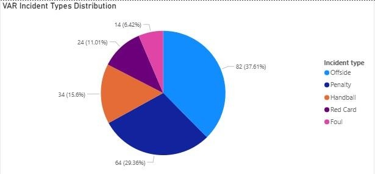
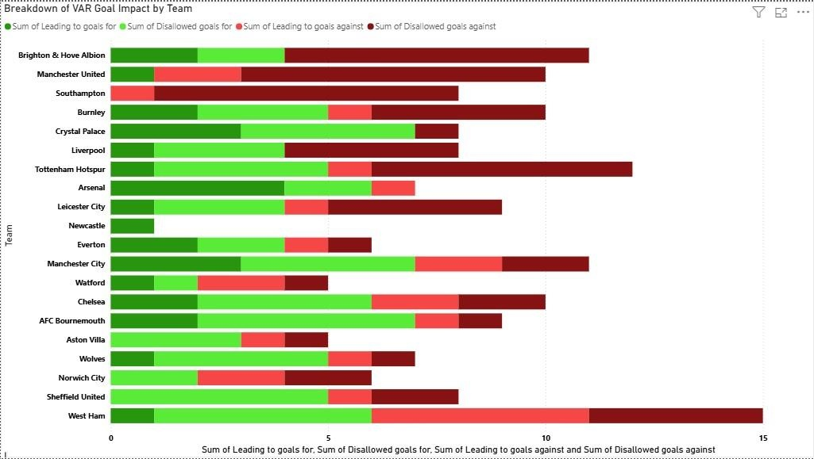

# VARalyze ⚽ | Premier League VAR Impact Analysis

An exploratory data analysis and interactive Power BI dashboard examining the impact of Video Assistant Referee (VAR) decisions during the **2019/20 Premier League season**.

## Project overview

- **Dataset:** FIFA VAR Incidents dataset (Kaggle)
- **Scope:** 20 clubs and 218 logged VAR incidents
- **Tools:** Power BI Desktop, Power Query (M), DAX
- **Focus:** Net goal impact, incident types, match timing, home/away outcomes, and subjective decisions

## Dashboard screenshots

### Overview

### Incident analysis

### Total and subjective decisions

## Key visualizations

### Net goal score by team

### VAR incident types

### Goal impact breakdown

## Key findings

- **Brighton & Hove Albion** had the highest net goal score from VAR (**+7**).
- **West Ham United** had the lowest net goal score (**−5**).
- **Offside** was the most common incident category: **82 incidents (37.6%)**.
- **Penalty** reviews accounted for **64 incidents (29.4%)**.
- The busiest five-minute window was **75–80 minutes**, with **26 incidents**.
- In this dataset, away teams had more favourable decisions than unfavourable ones, while home teams showed the opposite pattern.

## Questions explored

1. Which clubs gained or lost the most from VAR?
2. Which incident types were reviewed most often?
3. Did home and away outcomes differ?
4. When in a match did VAR incidents tend to occur?
5. Did subjective decisions tell the same story as the overall results?

## Data and interpretation notes

The incident-level and team-level tables were connected on `Team`. Dates were assigned to 2019 or 2020 based on the season calendar; entries without a day were left blank rather than guessed. Incident descriptions were grouped into categories such as Penalty, Red Card, Handball, Offside, Foul, and Other.

**Note:** These findings describe the dataset and its classifications; they should not be interpreted as proof that VAR alone caused a club's season outcome.

---
*Built with Power BI and Power Query.*
